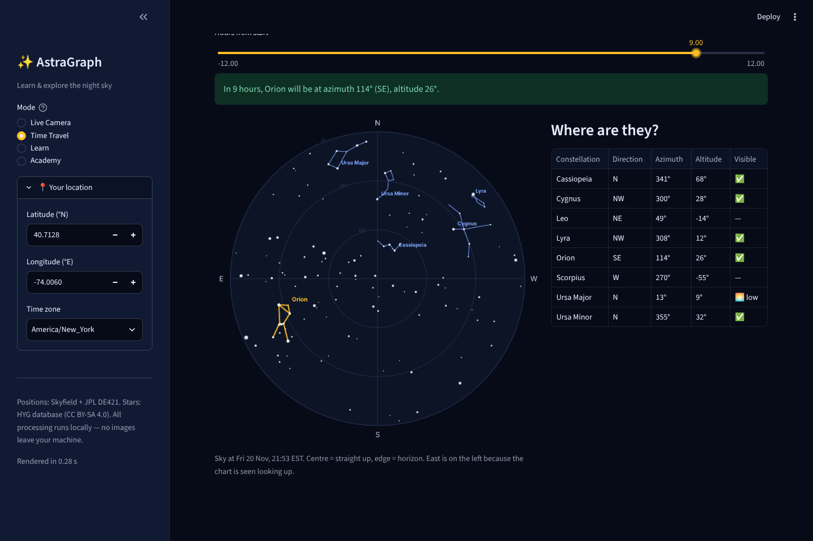
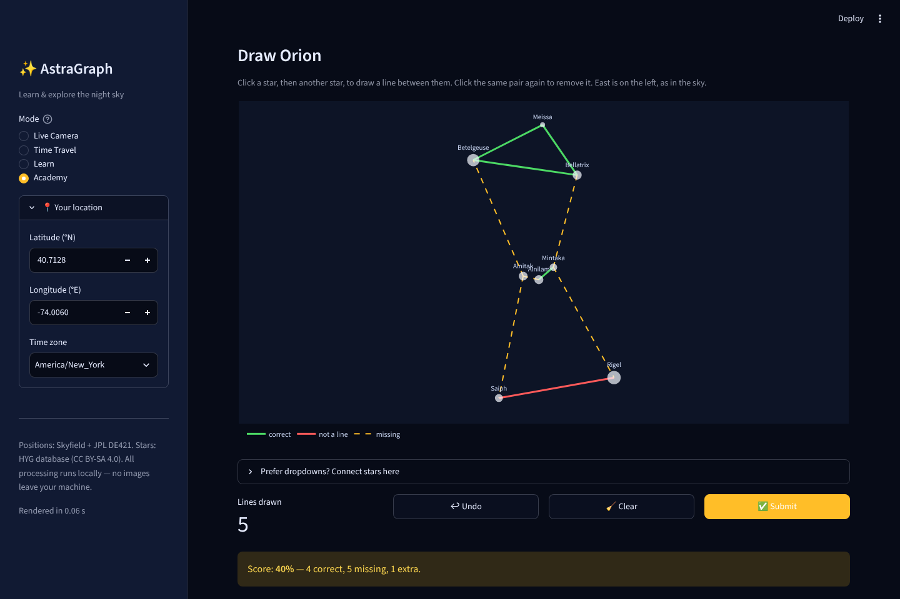
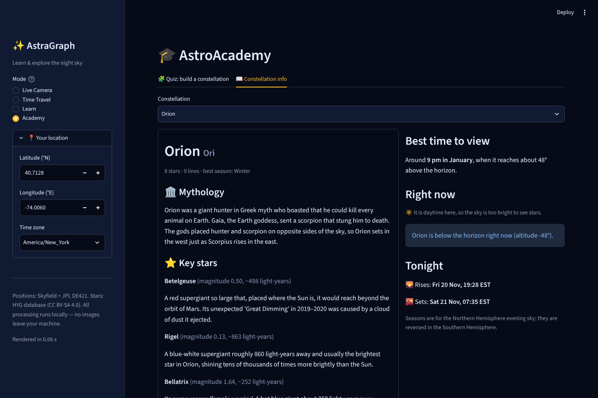

# AstraGraph

**Learn & explore the night sky.** AstraGraph finds constellations in camera
images by matching the *shape* of the stars rather than trusting the phone's
compass, predicts where everything will be at any time, and teaches the
connections behind it.

## Features

| Mode | What you can do |
| --- | --- |
| 🔭 **Live Camera** | Point a webcam at the sky, upload a photo or video, or run the built-in demo sky. Stars get green circles and the constellation gets gold lines with its name and confidence. Stars hidden by clouds are inferred and drawn as cyan "ghosts", satellites are tracked in red with their speed and direction, and bright objects missing from the catalog (such as planets) are flagged. |
| ⏳ **Time Travel** | Slide from −12 to +12 hours and watch the sky turn on a live sky chart: *"In 3 hours, Orion will be at azimuth 220°, altitude 45°."* It also warns you when the Sun is up. |
| 📚 **Learn** | Pick a constellation to see its chart, key stars, the best month to look, where it is right now and when it rises and sets tonight. |
| 🎓 **Academy** | **Quiz:** click stars to draw a constellation; you get a score, a "right shape, wrong stars" hint and the correct answer, with an optional hard mode that adds distractor stars. **Info:** the mythology, key stars with facts, best season and a fun fact for each constellation. |

Everything runs locally. Images never leave your computer.

## Why it is useful

- **Works without a reliable compass**: constellations are recognised from
  the geometry of the stars themselves, so a drifting magnetometer does not
  point you at the wrong part of the sky.
- **Robust to the real world**: clouds, trees and hand shake are expected,
  not errors.
- **Accurate predictions**: positions come from real astronomy (Skyfield +
  JPL DE421) and agree with an independent implementation to about 0.0001°.
- **Private by design**: every computation runs locally; no images or
  location data are sent anywhere.

## How it works

1. **See:** OpenCV finds bright point sources and filters out trails,
   noise and hot pixels (`detect.py`). A tracker keeps each star's ID stable
   from frame to frame (`track.py`).
2. **Connect:** stars become a graph. Union-find groups nearby stars, graph
   diffs produce events (appears, disappears, moves, satellite), and a
   geometric subgraph match against the constellation database identifies
   the figure regardless of rotation, zoom or hidden stars (`temporal.py`,
   `matcher.py`).
3. **Reason:** a forward-chaining rule engine turns facts into conclusions
   such as *identified*, *partial view → draw ghosts*, *satellite* and
   *anomaly* (`reason.py`).
4. **Predict:** Skyfield and the JPL DE421 ephemeris compute exactly where
   every star is for any time and place (`world_model.py`).
5. **Teach:** the same constellation graphs power the quiz, which grades
   your drawing as a graph (`academy.py`).

See [docs/ARCHITECTURE.md](docs/ARCHITECTURE.md) for the details.

## Installation

Requires Python 3.10 or newer.

```bash
git clone https://github.com/bhargavimw/AstraGraph.git
cd AstraGraph
python -m venv .venv
source .venv/bin/activate          # Windows: .venv\Scripts\activate
pip install -r requirements.txt
```

Everything needed at runtime is installed by pip; the JPL ephemeris comes with
the `skyfield-data` package, so no downloads happen when the app runs.

## Running the app

```bash
streamlit run app/demo.py
```

or `python scripts/run_app.py`. Streamlit opens http://localhost:8501.

- **Live Camera**: choose *Demo sky* to see the full pipeline on a rendered
  sky, *Webcam* for a live stream (allow camera access; browsers only allow it
  on `localhost` or HTTPS), or upload a photo/video.
- **Academy**: try the quiz (click two stars to draw a line between them)
  or read a constellation's info card.
- Set your location and time zone in the sidebar for Time Travel, Learn and
  the Academy info card.

Command-line demos and tests:

```bash
python scripts/demo_reasoning.py            # detection → tracking → reasoning
python scripts/demo_world_model.py          # visible constellations + sky map
python scripts/visualize_db.py              # render the constellation database
pytest                                      # full test suite
```

## Architecture

```
 camera frame
      │
      ▼
┌─────────────────────┐   ┌──────────────────────┐   ┌───────────────────────────┐
│ Computer Vision     │   │ Graphs & Reasoning   │   │ World Model               │
│                     │   │                      │   │                           │
│ detect.py           │──▶│ temporal.py          │   │ world_model.py (Skyfield) │
│  OpenCV blobs,      │   │  scene graph diffs,  │   │  star catalog + DE421     │
│  noise filters      │   │  union-find clusters,│   │  → alt/az at any time     │
│ track.py            │   │  APPEARS/DISAPPEARS/ │   │  → rise/set, best month   │
│  stable IDs,        │   │  MOVES/satellites    │   │  → constellation lookup   │
│  trajectories       │   │ matcher.py           │   │                           │
│                     │   │  geometric subgraph  │   │                           │
│                     │   │  matching (NetworkX) │   │                           │
│                     │   │ reason.py            │   │                           │
│                     │   │  forward-chaining    │   │                           │
│                     │   │  Horn rules          │   │                           │
└─────────────────────┘   └──────────┬───────────┘   └─────────────┬─────────────┘
                                     │                             │
                                     ▼                             ▼
                          ┌───────────────────────────────────────────────┐
                          │ app/demo.py (Streamlit)                       │
                          │ Live Camera · Time Travel · Learn · Academy   │
                          └───────────────────────────────────────────────┘
```

| Module | Role |
| --- | --- |
| `constellation_db.py` | 8 constellations as NetworkX graphs (J2000 star positions + stick-figure lines) |
| `detect.py` | Star detection with OpenCV `SimpleBlobDetector`; rejects trails, faint blobs, border blobs, hot pixels |
| `track.py` | Centroid tracking with velocity prediction; stable IDs through short occlusions |
| `temporal.py` | Temporal scene graph, debounced events, union-find clustering, satellite detection with camera-motion compensation |
| `matcher.py` | Rotation/scale-invariant constellation matching, partial views, mirror rejection, ghost-star projection |
| `reason.py` | Forward-chaining rule engine with fixpoint iteration |
| `spatial_plan.py` | Dijkstra over a sky-region graph to suggest a camera pan around obstructions |
| `pipeline.py` | Runs detector → tracker → temporal graph → matcher → reasoner per frame |
| `world_model.py` | Star positions, visibility, constellation lookup, rise/set times, Sun altitude |
| `academy.py` | Constellation info, star profiles, connect-the-dots quizzes graded as graphs |
| `app/` | Streamlit app and OpenCV overlay helpers |

## Screenshots

**Live Camera:** Orion identified in the demo sky, with two cloud-hidden stars
inferred as ghosts and a planet flagged as "not in catalog".


**Time Travel:** the sky over New York 9 hours ahead, with Orion highlighted.



**Academy quiz:** a graded attempt at Orion. Green lines are correct, red is
not part of the figure, and dashed gold lines were missing.



**Academy info card:** mythology, key stars and live position.



## Configuration

All thresholds live in `config.yaml`: detector brightness/size/aspect limits,
tracking grace periods, clustering distance, matcher tolerances, reasoning
thresholds and the default location for the world model.

## Future work

- Test and tune on real night-sky footage from phones (current tests use
  rendered skies).
- Make pixel thresholds (clustering distance, satellite speed) scale with the
  camera's field of view instead of being fixed in pixels.
- Use the phone's rough orientation as a prior so matching can draw on the
  full star catalog, not just the 8 constellations in the database.
- Live satellite passes (ISS, Starlink) from downloaded orbital elements,
  computed on the device.
- Add planets and the Moon to Time Travel.
- Package as a mobile app with on-device processing.
- More Academy content: all 88 constellations, the exoplanet transit
  light-curve lesson, binary stars and orbital hierarchies from the original
  design, and progress tracking across quizzes.

## Credits and acknowledgments

- Star data: [HYG Database](https://github.com/astronexus/HYG-Database) v4.1
  by David Nash (astronexus), CC BY-SA 4.0. `data/bright_stars.csv` is a
  derived subset under the same license.
- Ephemeris: NASA JPL DE421, via [Skyfield](https://rhodesmill.org/skyfield/)
  by Brandon Rhodes and the `skyfield-data` package.
- Constellation boundaries: International Astronomical Union, via Skyfield.
- Reference positions in the tests were cross-checked with
  [Astropy](https://www.astropy.org/) (ERFA / IAU SOFA).
- Built with [OpenCV](https://opencv.org/), [NetworkX](https://networkx.org/),
  [Streamlit](https://streamlit.io/), [streamlit-webrtc](https://github.com/whitphx/streamlit-webrtc),
  [Plotly](https://plotly.com/python/) and [Matplotlib](https://matplotlib.org/).
- Constellation stories draw on Greek mythology as recorded in classical
  sources such as Aratus, Eratosthenes and Ovid.
