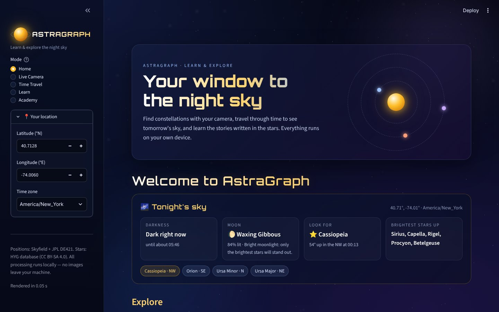
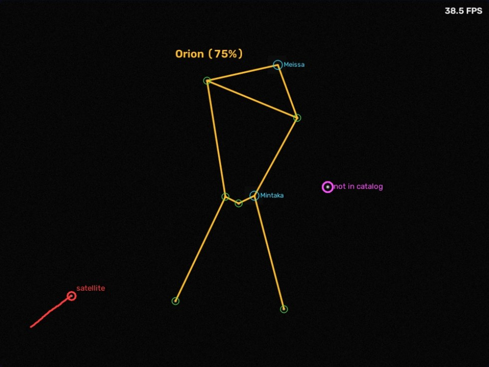
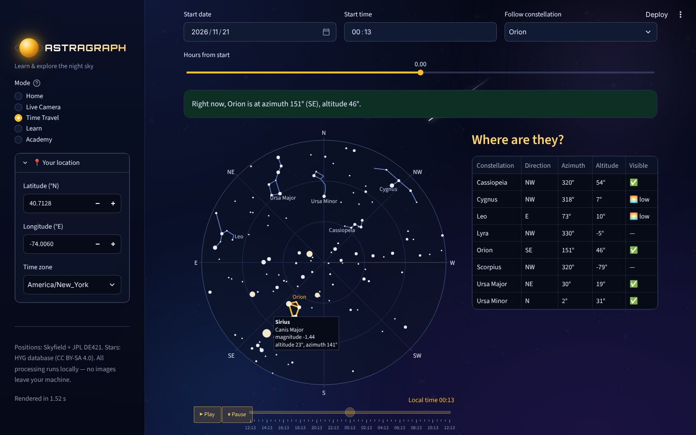
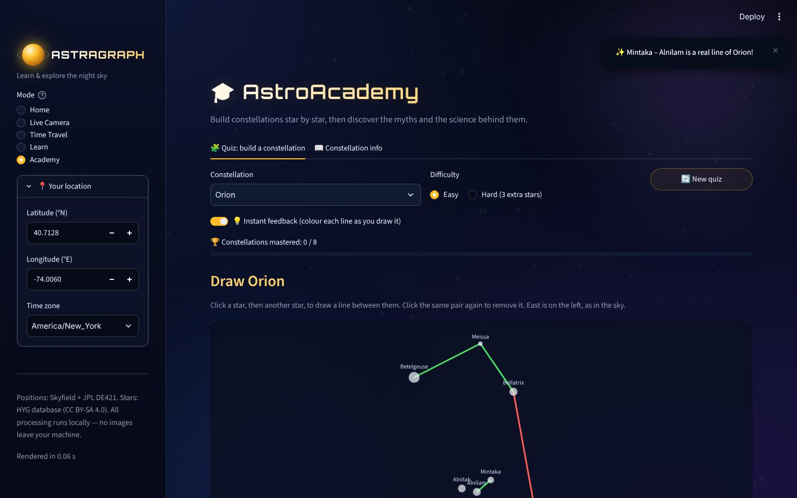

# AstraGraph

**Learn & explore the night sky.** AstraGraph finds constellations in camera
images by matching the *shape* of the stars rather than trusting the phone's
compass, predicts where everything will be at any time, and teaches the
connections behind it.

> **New here?** Jump to [Run the website locally](#run-the-website-locally).

## Features

| Mode | What you can do |
| --- | --- |
| 🏠 **Home** | A welcome page with an animated orrery and a **Tonight's sky** card for your location: when it gets dark, the Moon's phase (and whether it will wash out faint stars), the best constellation to look for and the brightest stars up. |
| 🔭 **Live Camera** | Point a webcam at the sky, upload a photo or video, or run the built-in demo sky. Stars get green circles and the constellation gets gold lines with its name and confidence. Stars hidden by clouds are inferred and drawn as cyan "ghosts", satellites are tracked in red with their speed and direction, and bright objects missing from the catalog (such as planets) are flagged. |
| ⏳ **Time Travel** | An interactive, animated sky chart: press ▶ Play to watch 24 hours of sky turn, drag the time bar, and hover any star for its name, constellation and brightness. The slider gives messages like *"In 3 hours, Orion will be at azimuth 220°, altitude 45°."*, with a warning when the Sun is up. |
| 📚 **Learn** | Pick a constellation to see its chart, key stars, the best month to look, where it is right now and when it rises and sets tonight. |
| 🖼️ **Gallery** | 36 pre-rendered sky wallpapers for nine cities in four styles, with filters, a lightbox and downloads. |

The current website has Home, Live Camera, Time Travel, Learn and Gallery. The
Academy quiz and info cards are still available in the legacy Streamlit app
(`app/`).

The whole app sits on an animated night sky (drifting, twinkling stars, a soft
nebula glow and the occasional shooting star); animation switches off when
your system asks for reduced motion. Everything runs locally, and images
never leave your computer.

## Why it is useful

- **Works without a reliable compass**: constellations are recognised from
  the geometry of the stars themselves, so a drifting magnetometer does not
  point you at the wrong part of the sky.
- **Robust to the real world**: clouds, trees and hand shake are expected,
  not errors.
- **Accurate predictions**: positions come from real astronomy (Skyfield +
  JPL DE421) and agree with an independent implementation to about 0.0001°.
- **Private by design**: every computation runs locally; no images or
  location data are sent anywhere.

## How it works

1. **See:** OpenCV finds bright point sources and filters out trails,
   noise and hot pixels (`detect.py`). A tracker keeps each star's ID stable
   from frame to frame (`track.py`).
2. **Connect:** stars become a graph. Union-find groups nearby stars, graph
   diffs produce events (appears, disappears, moves, satellite), and a
   geometric subgraph match against the constellation database identifies
   the figure regardless of rotation, zoom or hidden stars (`temporal.py`,
   `matcher.py`).
3. **Reason:** a forward-chaining rule engine turns facts into conclusions
   such as *identified*, *partial view → draw ghosts*, *satellite* and
   *anomaly* (`reason.py`).
4. **Predict:** Skyfield and the JPL DE421 ephemeris compute exactly where
   every star is for any time and place (`world_model.py`).
5. **Teach:** the same constellation graphs power the quiz, which grades
   your drawing as a graph (`academy.py`).

See [docs/ARCHITECTURE.md](docs/ARCHITECTURE.md) for the details.

## Project layout

```
.
├── web/        Next.js website — the current UI
├── api/        FastAPI service that serves the website
├── src/        astragraph library (detection, matching, reasoning, world model)
├── app/        legacy Streamlit UI
├── data/       constellation stick figures, bright stars and mythology
└── tests/
```

## Prerequisites

- Python 3.10 or newer
- Node.js 20.9 or newer (22 LTS recommended; Next.js 16 requires ≥ 20.9)

The website runs as two processes: the FastAPI API and the Next.js frontend.
Start them in two terminals.

## Run the website locally

Clone the repository and start the API:

```bash
git clone https://github.com/bhargavimw/AstraGraph.git
cd AstraGraph

python3 -m venv .venv
source .venv/bin/activate          # Windows: .venv\Scripts\activate
pip install -r api/requirements.txt
uvicorn api.main:app --reload --port 8000
```

Run `uvicorn` from the repository root: the API loads `config.yaml` and `data/`
relative to it, and adds `src/` to the import path. Everything needed at runtime
is installed by pip; the JPL ephemeris comes with the `skyfield-data` package,
so no downloads happen when the app runs.

In a second terminal, from the repository root, start the website:

```bash
cd web
npm install
cp .env.example .env.local         # points at http://localhost:8000 by default
npm run dev
```

Open:

- Website: <http://localhost:3000>
- API documentation: <http://localhost:8000/docs>
- API health check: <http://localhost:8000/health>

The gallery (`/gallery`) is static and works without the API. The other pages
load data from it, so if they stay on "Waking the telescope…", the API is not
reachable.

### Environment variables

`web/.env.local`:

| Variable | Purpose |
| --- | --- |
| `NEXT_PUBLIC_API_URL` | Base URL of the API, without a trailing slash (default `http://localhost:8000`). |
| `NEXT_PUBLIC_SITE_URL` | Optional public site URL, used for absolute share-image links. |

If you change the frontend port, allow that origin on the API:

```bash
ASTRAGRAPH_ALLOWED_ORIGINS=http://localhost:3001 uvicorn api.main:app --port 8000
```

Live Camera needs camera permission. Browsers only allow camera access on
`localhost` or HTTPS.

### Troubleshooting

- **`next` reports an unsupported Node version**: switch to Node 22, e.g.
  `nvm use 22`.
- **Port 8000 is already in use**: run the API on another port and point the
  website at it, e.g. `uvicorn api.main:app --port 8001` and
  `NEXT_PUBLIC_API_URL=http://localhost:8001` in `web/.env.local`.
- **Pages stay on "Waking the telescope…"**: the API is not running or the URL
  is wrong; check `curl http://localhost:8000/health`.

## Legacy Streamlit app

The original single-process UI is still in `app/`. It needs the full Python
requirements (Streamlit, Plotly, pandas):

```bash
source .venv/bin/activate
pip install -r requirements.txt
python scripts/run_app.py          # http://localhost:8501
```

- **Live Camera**: choose *Demo sky* to see the full pipeline on a rendered
  sky, *Webcam* for a live stream, or upload a photo/video.
- **Academy**: try the quiz (click two stars to draw a line between them)
  or read a constellation's info card.
- Set your location and time zone in the sidebar for Time Travel, Learn and
  the Academy info card.

## Tests and demos

```bash
source .venv/bin/activate
pip install pytest httpx
python -m pytest tests/test_api.py tests/test_constellation_db.py tests/test_academy.py \
  tests/test_detect.py tests/test_reasoning.py tests/test_temporal.py tests/test_world_model.py
```

`tests/test_app.py` covers the legacy Streamlit app and needs
`pip install -r requirements.txt`.

Command-line demos:

```bash
python scripts/demo_reasoning.py            # detection → tracking → reasoning
python scripts/demo_world_model.py          # visible constellations + sky map
python scripts/visualize_db.py              # render the constellation database
```

## Architecture

```
 camera frame
      │
      ▼
┌─────────────────────┐   ┌──────────────────────┐   ┌───────────────────────────┐
│ Computer Vision     │   │ Graphs & Reasoning   │   │ World Model               │
│                     │   │                      │   │                           │
│ detect.py           │──▶│ temporal.py          │   │ world_model.py (Skyfield) │
│  OpenCV blobs,      │   │  scene graph diffs,  │   │  star catalog + DE421     │
│  noise filters      │   │  union-find clusters,│   │  → alt/az at any time     │
│ track.py            │   │  APPEARS/DISAPPEARS/ │   │  → rise/set, best month   │
│  stable IDs,        │   │  MOVES/satellites    │   │  → constellation lookup   │
│  trajectories       │   │ matcher.py           │   │                           │
│                     │   │  geometric subgraph  │   │                           │
│                     │   │  matching (NetworkX) │   │                           │
│                     │   │ reason.py            │   │                           │
│                     │   │  forward-chaining    │   │                           │
│                     │   │  Horn rules          │   │                           │
└─────────────────────┘   └──────────┬───────────┘   └─────────────┬─────────────┘
                                     │                             │
                                     ▼                             ▼
                          ┌───────────────────────────────────────────────┐
                          │ web/ (Next.js) ──▶ api/ (FastAPI)             │
                          │ app/demo.py (Streamlit, legacy)               │
                          └───────────────────────────────────────────────┘
```

| Module | Role |
| --- | --- |
| `constellation_db.py` | 8 constellations as NetworkX graphs (J2000 star positions + stick-figure lines) |
| `detect.py` | Star detection with OpenCV `SimpleBlobDetector`; rejects trails, faint blobs, border blobs, hot pixels |
| `track.py` | Centroid tracking with velocity prediction; stable IDs through short occlusions |
| `temporal.py` | Temporal scene graph, debounced events, union-find clustering, satellite detection with camera-motion compensation |
| `matcher.py` | Rotation/scale-invariant constellation matching, partial views, mirror rejection, ghost-star projection |
| `reason.py` | Forward-chaining rule engine with fixpoint iteration |
| `spatial_plan.py` | Dijkstra over a sky-region graph to suggest a camera pan around obstructions |
| `pipeline.py` | Runs detector → tracker → temporal graph → matcher → reasoner per frame |
| `world_model.py` | Star positions, visibility, constellation lookup, rise/set times, Sun altitude |
| `academy.py` | Constellation info, star profiles, connect-the-dots quizzes graded as graphs |
| `api/` | FastAPI service for the website: `/sky`, `/tonight`, `/frame`, `/constellations`, `/quiz` and `/demo-sky` |
| `web/` | Next.js website (App Router, TypeScript, Tailwind, Framer Motion); calls `api/` and bundles its star catalogue |
| `app/` | Legacy Streamlit app: `demo.py` (pages), `theme.py` (animated sky and styling), `sky_chart.py` (animated Plotly chart), `tonight.py` (Tonight's sky), `utils.py` (OpenCV overlays) |

## Screenshots

The screenshots below are from the Streamlit app. The Next.js website has Home,
Live Camera, Time Travel, Learn and Gallery; the Academy screens are from the
legacy app.

**Home:** Tonight's sky for your location, over the animated starfield.



**Live Camera:** Orion identified in the demo sky, with two cloud-hidden stars
inferred as ghosts and a planet flagged as "not in catalog".



**Time Travel:** the animated sky chart with Orion highlighted and a star's
hover card; press ▶ Play to watch the sky turn.



**Academy quiz:** drawing Orion with instant feedback on: green lines are
real, red ones are not part of the figure.



**Academy info card:** mythology, key stars and live position.


## Configuration

All thresholds live in `config.yaml`: detector brightness/size/aspect limits,
tracking grace periods, clustering distance, matcher tolerances, reasoning
thresholds and the default location for the world model.

## Future work

- Test and tune on real night-sky footage from phones (current tests use
  rendered skies).
- Make pixel thresholds (clustering distance, satellite speed) scale with the
  camera's field of view instead of being fixed in pixels.
- Use the phone's rough orientation as a prior so matching can draw on the
  full star catalog, not just the 8 constellations in the database.
- Live satellite passes (ISS, Starlink) from downloaded orbital elements,
  computed on the device.
- Add planets and the Moon to Time Travel.
- Package as a mobile app with on-device processing.
- More Academy content: all 88 constellations, the exoplanet transit
  light-curve lesson, binary stars and orbital hierarchies from the original
  design, and progress tracking across quizzes.

## Credits and acknowledgments

- Star data: [HYG Database](https://github.com/astronexus/HYG-Database) v4.1
  by David Nash (astronexus), CC BY-SA 4.0. `data/bright_stars.csv` is a
  derived subset under the same license.
- Ephemeris: NASA JPL DE421, via [Skyfield](https://rhodesmill.org/skyfield/)
  by Brandon Rhodes and the `skyfield-data` package.
- Constellation boundaries: International Astronomical Union, via Skyfield.
- Reference positions in the tests were cross-checked with
  [Astropy](https://www.astropy.org/) (ERFA / IAU SOFA).
- Built with [Next.js](https://nextjs.org/), [React](https://react.dev/),
  [Tailwind CSS](https://tailwindcss.com/), [FastAPI](https://fastapi.tiangolo.com/),
  [OpenCV](https://opencv.org/), [NetworkX](https://networkx.org/),
  [Streamlit](https://streamlit.io/), [streamlit-webrtc](https://github.com/whitphx/streamlit-webrtc),
  [Plotly](https://plotly.com/python/) and [Matplotlib](https://matplotlib.org/).
- Constellation stories draw on Greek mythology as recorded in classical
  sources such as Aratus, Eratosthenes and Ovid.
